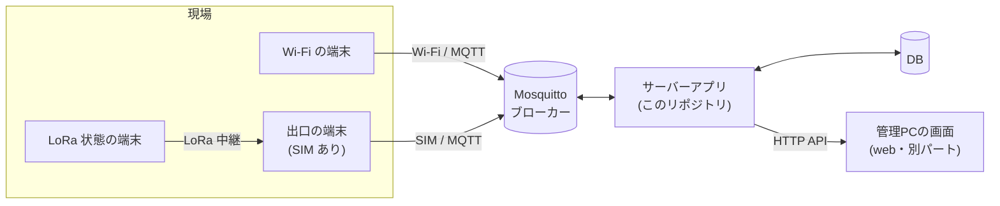

# Re-Ray_Server

**Re-Ray(晩ご飯はtype-C)のサーバー側(管理PC・検証用)**

端末から MQTT で届く情報を保存し、管理PCの画面に渡し、画面から頼まれた文字を端末へ送る。
これは「できる/できない」を事実で確かめる**検証用**であり、製品コードではない。

> [!NOTE]
> ハード側の試作(T-Beam・XIAO・GUIDE01)は別リポジトリ [`tkitora/re-ray`](https://github.com/tkitora/re-ray)(p-02)。

---

## 1. サーバーの役割

チームの仕様(サーバーサイド `01_API`)のとおり、3つ。

| # | 役割 | 流れ |
|---|---|---|
| 1 | 端末から届いたものを残す | 端末 → MQTT → **サーバー → DB** |
| 2 | 画面に状態と記録を渡す | DB → **サーバー → 管理PCの画面** |
| 3 | 画面から頼まれた文字を送る | 管理PCの画面 → **サーバー** → MQTT → 端末 |

### 検証で確かめること

- [ ] signal・status・ack を、重複や遅れがあっても正しく保存・表示できるか
- [ ] 個別・一斉に文字(text)を送れるか
- [ ] 送った文字が「何台に届いたか」が分かるか(「6台中4台に届いた」)
- [ ] 端末が「切れた」ことを、誤りなく判定できるか
- [ ] ログが残り、後から見返せるか(企画書の「言った言わない」を減らす)

---

## 2. 構成



- Wi-Fi の端末は、MQTT でブローカーに**直接**つなぐ。
- Wi-Fi が使えない端末は LoRa で中継し、**出口の端末が JSON にして**代わりに流す(`via = lora`)。
- 保存・判定(online など)・文字の送信の管理は、**すべてサーバーが持つ**。
- 出口がつながっていない間も、現場側(LoRa)は動き続ける。サーバーは「遅れて届く」「2回届く」を前提にする。

### 構成要素

| 要素 | 内容 |
|---|---|
| ブローカー | Mosquitto(`config/mosquitto.conf`)。置き場所は未決 |
| サーバーアプリ | MQTT の購読・検証・重複排除・保存、端末の状態の判定、文字の送信と ack の集計、HTTP API |
| DB | チーム案の4表(devices / messages / signals / acks)+ 原本 events【追加案】。第一候補は SQLite |
| 管理PCの画面 | 別パート。サーバーの API を使う |
| 疑似端末ツール | 実機なしで signal / status / ack を流す検証用スクリプト(`tools/`)【追加案】 |

---

## 3. 文書の読み方

### 3.1 どの情報を信じるか

| 優先 | 情報 | 扱い |
|---|---|---|
| **1** | チーム共有の仕様 md(2026-10-13 のたたき台) | **正**。食い違ったらこちらに合わせる |
| **2** | 仕様修正案(2026-10-16、食い違い5点) | チームの**合意待ち** |
| **3** | `tkitora/re-ray`(ハード試作) | 参考。違う点は `docs/INTERFACES.md` §7 に記録 |

### 3.2 表記

| 表記 | 意味 |
|---|---|
| 【案】 | チームのたたき台で「案」とされているもの。決まったら案を外す |
| 【修正案】 | 仕様修正案(10/16)のもの。合意したら、共通仕様の md を直してからここも直す |
| 【追加案】 | このリポジトリだけの提案(サーバー側で完結する)。不要なら外してよい |

> [!IMPORTANT]
> パート間で使う値は、**先に共通仕様へ書いてからコードに使う**。

### 3.3 目的別:どこを読むか

| 知りたいこと | 読むところ |
|---|---|
| 全体の作りと考え方 | `docs/ARCHITECTURE.md` |
| MQTT の JSON、API の形 | `docs/INTERFACES.md` |
| DB のテーブル | `docs/DATA_MODEL.md` |
| 何をどう確かめるか | `docs/TEST_PLAN.md` |
| ハード試作との食い違い | `docs/INTERFACES.md` §7 |

---

## 4. 企画書の主張と、確かめるテスト

| 企画書の主張 | サーバー側で確かめること | テスト |
|---|---|---|
| 管理PCで端末単位の状況を一覧できる | 端末ごとの online・経路・電池・グラス・最後の定型信号を API で返す | M2 |
| 管理PCから個別・一斉に送れる | text を DB に保存してから MQTT で送る | M3 |
| 届いたかが分かる | ack を集め「N台中M台に届いた」を出す。Wi-Fi 外の端末は別に数える【修正案】 | M3 |
| ログが残り、後から見返せる | 受信・送信の記録を、端末・種類・日付で引ける | M1, M2 |
| 回線断でも動く【修正案】<br>(上りは LoRa で届き、下りは Wi-Fi が戻れば届く) | 遅れて届いた signal を正しく扱い、Wi-Fi に戻った端末へ text が届く | M4, M5 |

## 5. 進め方

詳細は `docs/TEST_PLAN.md`。

| 段階 | 内容 |
|---|---|
| **M0** | 方針の確定(言語・DB・ブローカーの置き場所)。**コードを書かない** |
| **M1** | Mosquitto + サーバーアプリ。疑似端末の signal を保存(上りの最小経路) |
| **M2** | status と online の判定、端末一覧・詳細・記録の API |
| **M3** | text の送信(個別・一斉)と ack の集計 |
| **M4** | 異常系:重複、遅延、不正な JSON、未知の端末、再起動、LoRa 状態の端末 |
| **M5** | 実機結合:出口から実際の signal を受信、回線断の模擬と復旧 |

## 6. 使い方(M1 以降。言語を決めたら具体化する)

```powershell
# ブローカーを起動(ローカル LAN のみ)
mosquitto -c config/mosquitto.conf -v

# サーバーアプリ・疑似端末の実行は、M0 で言語を決めたあとにここへ書く
```

## 7. フォルダ構成

```
Re-Ray_Server/
├── README.md
├── docs/
│   ├── ARCHITECTURE.md    設計書(構成、データの流れ、online の判定、技術選定)
│   ├── INTERFACES.md      MQTT の JSON、HTTP API、ハード試作との差
│   ├── DATA_MODEL.md      テーブル、集計規則
│   └── TEST_PLAN.md       M1〜M5 の手順と合格基準(案)
├── config/
│   └── mosquitto.conf     検証用のブローカー設定
├── src/                   サーバーアプリ(言語を決めたあとに作る)
├── tools/                 疑似端末ツール、ログの解析スクリプト
├── data/                  DB ファイルなど(git 管理外)
└── logs/                  サーバーのログ、実測ログ(git 管理外)
```

管理PCの画面(web)は別パートのため、このリポジトリには作らない。

---

## 8. 未決・要確認

### 8.1 チーム仕様で未決のもの

| # | 内容 | 状態 |
|---|---|---|
| 1 | 言語・フレームワーク、DB の種類 | M0 で決める(`ARCHITECTURE.md` §10 に比較と推奨案) |
| 2 | サーバーの置き場所(回線断でも届くよう、本番はネット上) | 検証版は手元の PC |
| 3 | ブローカーの置き場所・製品・認証 | 未決(共通仕様 03) |
| 4 | 新着の知らせ方(画面が取りに来る / サーバーから押し出す) | 未決。両方に対応できる形(`INTERFACES.md` §5) |
| 5 | web は MQTT 直結か、API 経由か | 未決。API 経由で書いた |
| 6 | ログインと、API を守る方法 | 未決。検証版は認証なし |
| 7 | ログの保存期間、`users` 表を作るか | 未決 |
| 8 | status が途絶えたら SOS 扱いにするか | 【修正案】v1 は SOS 扱いにしない |
| 9 | ack をどこまで出すか | 【修正案】v1 は「端末に届いた」まで |

### 8.2 仕様修正案の合意待ち

サーバーの作りに影響するもの:

- text の `mid` と、ack の `ack_mid`
- `online` の更新者(サーバーだけ)と判定時間
- LoRa の心拍(status の形)
- `(device_id, seq)` に一意制約を付けないこと

> [!WARNING]
> **合意前は、これらの変更に合わせて作らない。** 合意前の暫定の動きは `docs/INTERFACES.md` §2.4。

---

## 9. 注意

- `config/mosquitto.conf` の `allow_anonymous true` は**検証専用**。ローカル LAN のみで使い、検証後は止める。製品では認証と TLS を使う。
- API には、検証版では認証を付けない。**インターネットに公開しない。**
- 接続情報や鍵は git に入れない(`.env` などに置き、`.gitignore` で除外)。パスワードはこのリポジトリに書かない(共通仕様 03 の決まり)。

## 10. 更新履歴

| 日付 | 内容 |
|---|---|
| 2026-10-16 | 初版。`tkitora/re-ray` を参考に作成 |
| 2026-10-16 | チーム仕様(10/13)と仕様修正案(10/16)に合わせて全面更新。区域・指示の仕組みを外した |
| 2026-10-16 | 読みやすさを改善(要点・読み方の案内、構成図を mermaid に、表の整理)。内容は変更なし |
