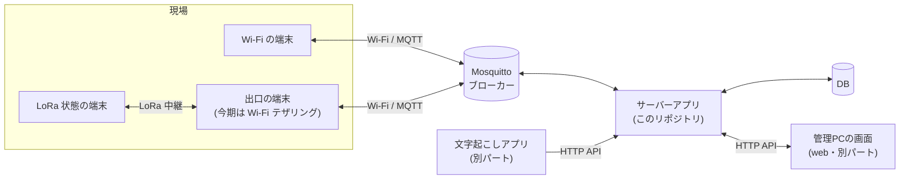

# Re-Ray_Server

**Re-Ray(晩ご飯はtype-C)のサーバー側(管理PC・検証用)**

端末から MQTT で届く情報を保存し、管理PCの画面に渡し、画面から頼まれた文字を端末へ送る。
これは「できる/できない」を事実で確かめる**検証用**であり、製品コードではない。

> [!NOTE]
> ハード側の試作(T-Beam・XIAO・GUIDE01)は別リポジトリ [`tkitora/re-ray`](https://github.com/tkitora/re-ray)(p-02)。

---

## 1. サーバーの役割

チームの仕様(サーバーサイド `01_API`)のとおり、3つ。

| # | 役割 | 流れ |
|---|---|---|
| 1 | 端末から届いたものを残す | 端末 → MQTT → **サーバー → DB** |
| 2 | 画面に状態と記録を渡す | DB → **サーバー → 管理PCの画面** |
| 3 | 画面から頼まれた文字・指示を送る | 管理PCの画面・文字起こしアプリ → **サーバー** → MQTT → 端末 |

10/20 の決定で、サーバーは**ポジション表・指示コード表**も持ち、**文字起こしの文**も配る(`docs/INTERFACES_2026-10-23.md` §4.3)。

### 検証で確かめること

- [ ] signal・status・ack を、重複や遅れがあっても正しく保存・表示できるか(疑似端末 100 台ぶん、欠け・重複なし)
- [ ] 個別・一斉に文字(text)と指示コード(+ポジション)を送れるか
- [ ] signal を受けたら、端末に「本部に届いた」を返せるか【案】
- [ ] 送った文字が「何台に届いたか」が分かるか(「6台中4台に届いた」)
- [ ] 端末が「切れた」ことを、誤りなく判定できるか
- [ ] ログが残り、後から見返せるか(企画書の「言った言わない」を減らす)

---

## 2. 構成



- Wi-Fi の端末は、MQTT でブローカーに**直接**つなぐ。
- Wi-Fi が使えない端末は LoRa で中継し、**出口の端末が受け取ったフレームを生のまま**流す。サーバーが分解して署名を確かめる(`via = lora`)【案】(`docs/GATEWAY_RAW_FORMAT_2026-10-23.md`)。
- 下りの指示コードと「本部に届いた」は、出口が LoRa に直して流す【案】。
- 保存・判定(online など)・文字の送信の管理は、**すべてサーバーが持つ**。
- 出口がつながっていない間も、現場側(LoRa)は動き続ける。サーバーは「遅れて届く」「2回届く」を前提にする。

### 構成要素

| 要素 | 内容 |
|---|---|
| ブローカー | Mosquitto(`config/mosquitto.conf`)。本番に移るまでは Docker、本番の置き場所は未決 |
| サーバーアプリ | MQTT の購読・検証・重複排除・保存、端末の状態の判定、文字の送信と ack の集計、HTTP API(`src/`) |
| DB | **MySQL**。表は DB の担当の B 案(`db/init/01_schema.sql`)+ サーバーが足してほしいもの(`03_server.sql`。原本 events など)。サーバーは保存の窓口(`src/storage/types.ts`)だけを使う |
| 管理PCの画面 | やまさん作(別パート)。2026-11-06 に `web/` に取り込み、サーバーが配る(`web/README.md`) |
| 疑似端末ツール | 実機なしで signal / status / ack を流す検証用スクリプト(`tools/`)と、サーバーの中の偽の端末(`DEV_TOOLS=1`)【追加案】 |

---

## 3. 文書の読み方

### 3.1 どの情報を信じるか

| 優先 | 情報 | 扱い |
|---|---|---|
| **1** | 10/20 の決定(`00_進め方と目標` / `01_要件定義` / `02_機能一覧`) | **今の正**。共通仕様より新しい |
| **2** | チーム共有の仕様 md(2026-10-13 のたたき台) | 10/20 の決定と食い違うところは、共通仕様が直るまで【案】で書く(`docs/INTERFACES_2026-10-23.md` §8) |
| **3** | 仕様修正案(2026-10-16、5点) | #3・#4 は採用、#2 は反映待ち、#1 は一部置きかえ(`docs/ARCHITECTURE_2026-10-23.md` §11) |
| **4** | `tkitora/re-ray`(ハード試作) | 参考。違う点は `docs/INTERFACES_2026-10-23.md` §7 に記録 |

### 3.2 表記

| 表記 | 意味 |
|---|---|
| 【案】 | チームのたたき台で「案」とされているもの、または 10/20 の決定を受けたサーバー側の案で、共通仕様にまだ無いもの。決まったら案を外す |
| 【修正案】 | 仕様修正案(10/16)のもの。合意したら、共通仕様の md を直してからここも直す |
| 【追加案】 | このリポジトリだけの提案(サーバー側で完結する)。不要なら外してよい |
| 【将来】 | 今期は作らず、あとから足す機能の設計メモ(例:普段用の音声の文字起こし) |

> [!IMPORTANT]
> パート間で使う値は、**先に共通仕様へ書いてからコードに使う**。

### 3.3 目的別:どこを読むか

| 知りたいこと | 読むところ |
|---|---|
| 全体の作りと考え方 | `docs/ARCHITECTURE_2026-10-23.md` |
| 文字起こしの災害用・普段用と作る順番 | `docs/ARCHITECTURE_2026-10-23.md` §12 |
| MQTT の JSON、API の形 | `docs/INTERFACES_2026-10-23.md` |
| DB のテーブル | `docs/DATA_MODEL_2026-10-23.md` |
| MQTT・DB で必ず渡す項目(早見表) | `docs/FIELDS_2026-10-23.md` |
| 受け取ったものを DB・送り先に何を渡すか(例つき) | `docs/DATAFLOW_2026-10-23.md` |
| 定型信号・救援コードの形、数量 `n`・方角 `dir`、定型信号の一覧(叩き台) | `docs/SIGNAL_FORMAT_2026-10-23.md` |
| 出口から生のまま届く LoRa のフレームを、サーバーがどう分解するか | `docs/GATEWAY_RAW_FORMAT_2026-10-23.md` |
| DB の担当(すみださん)のテーブル定義案との違い、DB 修正依頼の案 | `docs/DB案の比較_2026-11-06.md` |
| 何をどう確かめるか | `docs/TEST_PLAN_2026-10-22.md` |
| ハード試作との食い違い | `docs/INTERFACES_2026-10-23.md` §7 |

---

## 4. 企画書の主張と、確かめるテスト

| 企画書の主張 | サーバー側で確かめること | テスト |
|---|---|---|
| 管理PCで端末単位の状況を一覧できる | 端末ごとの online・経路・電池・グラス・最後の定型信号を API で返す | M2 |
| 管理PCから個別・一斉に送れる | text・指示コードを DB に保存してから MQTT で送る | M3 |
| 届いたかが分かる | ack を集め「N台中M台に届いた」を出す。自由な文では Wi-Fi 外の端末を別に数える。端末に「本部に届いた」を返す【案】 | M3 |
| ログが残り、後から見返せる | 受信・送信の記録を、端末・種類・日付で引ける | M1, M2 |
| 話した内容がグラスに出る | 文字起こしの文を受けて記録し、配る【案】 | M3 |
| 回線断でも動く<br>(上りは LoRa で届き、下りは指示コードなら LoRa で、自由な文は Wi-Fi が戻れば届く) | 遅れて届いた signal を正しく扱う。指示コードを LoRa 宛てにも出す。Wi-Fi に戻った端末へ text が届く | M4, M5 |

## 5. 進め方

詳細は `docs/TEST_PLAN_2026-10-22.md`。

| 段階 | 内容 |
|---|---|
| **M0** | 方針の確定(言語・DB・ブローカーの置き場所)。**コードを書かない** |
| **M1** | Mosquitto + サーバーアプリ。疑似端末の signal を保存(上りの最小経路) |
| **M2** | status と online の判定、端末一覧・詳細・記録の API |
| **M3** | text の送信(個別・一斉)と ack の集計 |
| **M4** | 異常系:重複、遅延、不正な JSON、未知の端末、再起動、LoRa 状態の端末 |
| **M5** | 実機結合:出口から実際の signal を受信、回線断の模擬と復旧 |

## 6. 使い方

サーバーアプリは **TypeScript(Node.js 24 以上)**。本番に移るまでは、**MQTT ブローカー(Mosquitto)と DB(MySQL)を Docker で**動かす。サーバーアプリはふだん手元で動かす(保存するとすぐ再起動できるため)。

| 動かすもの | 場所 | ポート |
|---|---|---|
| Mosquitto 2.0 | Docker | 1883 |
| MySQL 8.4 | Docker | **3307**(PC に別の MySQL が入っていても 3306 とぶつからないように) |
| サーバーアプリ(管理画面と API) | 手元(`npm run dev`)。本番に近い形で試すときだけ Docker | 3000 |

### 6.1 はじめての人へ:手元に環境を作る

#### 前提:先に入れておくもの

下の 3 つが入っていて、確かめるコマンドが通る状態から始める。

| 入れるもの | 入れ方 | 確かめるコマンド |
|---|---|---|
| Git | https://git-scm.com/ から入れる | `git --version` で版が出る |
| Node.js 24 | https://nodejs.org/ から「24」の LTS 版を入れる。nvm(nvm-windows)を使っている人は `nvm install 24` → `nvm use 24`(`.nvmrc` に 24 と書いてある) | `node -v` が `v24.` で始まる |
| Docker Desktop | https://www.docker.com/products/docker-desktop/ から入れる(Windows は途中で WSL2 を入れるよう言われたら従い、PC を再起動する) | `docker compose version` で版が出る |

- **入れたあとは VS Code(ターミナル)を完全に閉じて開き直す**。開いたままだと、古い PATH のままで `docker : 用語 'docker' は…認識されません` や `node` が見つからないと出る。ウィンドウが複数あれば全部閉じる。直らなければ PC を再起動する
- **Docker Desktop は起動しておく**。タスクバーのクジラのアイコンが動いていて、Docker Desktop の左下が「Engine running」(緑)なら起動している。起動していないと `error during connect` と出る
- PowerShell で `npm` を打って「スクリプトの実行が無効」と出たら、一度だけ `Set-ExecutionPolicy -Scope CurrentUser RemoteSigned` を打つ

#### 手順

1. **リポジトリを手元に持ってくる**
   ```powershell
   git clone https://github.com/yuki20060410/Re-Ray_Server.git
   cd Re-Ray_Server
   ```
2. **依存パッケージを入れる**
   ```powershell
   npm ci
   ```
   - `npm ci` は `package-lock.json` のとおりに入れるので、**全員が同じバージョン**になる。`npm install` だとバージョンがずれることがある
   - Node が 24 より古いと、ここでエラーになる(`.npmrc` の `engine-strict`)。前提の Node.js 24 を入れ直す
3. **接続情報のファイルを作る**
   ```powershell
   Copy-Item .env.example .env    # Mac・Linux は cp .env.example .env
   ```
   - `.env` を開き、`DB_PASS` と `DB_ROOT_PASS` に**自分で決めたパスワード**を入れる(空のままだと次の手順で止まる)。`.env` は git に入らない。**パスワードを `.env.example` に書かない**
4. **Docker で Mosquitto と MySQL を起動する**
   ```powershell
   npm run docker:up
   docker compose ps     # mosquitto と mysql が Up、mysql が (healthy) になれば OK
   ```
   - はじめての起動では、イメージのダウンロードに数分かかる
5. **動くか確かめる**
   ```powershell
   npm run typecheck   # 何も出なければ OK
   npm run dev         # 「Re-Ray_Server: 起動しました」と出れば OK(Ctrl+C で止める)
   ```
   - ブラウザで http://localhost:3000 を開くと管理画面が出る
   - 保存先は `.env` の `STORAGE`(`mysql` = Docker の MySQL、`memory` = メモリ版で再起動すると消える)

**DB を空に戻したいとき**:`docker compose down -v`(**DB のデータが全部消える**)→ `npm run docker:up`。`db/init/` の表の定義が流れ直す。
2026-11-06 より前に MySQL を起動したことがある人は、表がまだ無いので、一度これをやる(`db/init/` の .sql は、はじめての起動でしか流れない)。

**画面を見るための見本を入れるとき**:`Get-Content db/demo/demo_data.sql | docker compose exec -T mysql mysql -ureray -p reray`(端末 5 台、信号、送信の記録。本番の DB には入れない)

**パッケージを足すとき**:`npm install パッケージ名` で入れ、変わった `package.json` と `package-lock.json` を**両方**コミットする。ほかの人は pull したあと `npm ci` をやり直す。

### 6.2 ふだんのコマンド

```powershell
# Mosquitto と MySQL を起動 / 止める / ログを見る
npm run docker:up
npm run docker:down
npm run docker:logs

# MySQL に入って中を見る(パスワードは .env の DB_PASS)
docker compose exec mysql mysql -ureray -p reray

# サーバーアプリも Docker で動かす(本番に近い形で試すとき)
npm run docker:app

# サーバーアプリを開発モードで起動(保存すると自動で再起動)
npm run dev

# ビルドして実行
npm run build
npm start

# 型チェックだけ
npm run typecheck

# テスト(src の *.test.ts を全部流す。Docker は要らない)
npm test

# 保存の窓口の約束のテストを、Docker の MySQL で流す(reray_test という別の DB を毎回作り直す。開発用の DB は触らない)
npm run test:mysql

# 負荷の試験(サーバーを起動したまま。偽の端末 100 台が同時に送り、欠け・重複が無いかを API で数える)
npm run load-test

# 管理画面だけを偽のサーバーで開く(http://localhost:8080。サーバーも Docker も要らない)
npm run web:mock

# 疑似端末ツール(実機なしで端末の代わりに流す。使い方の全部は tools/fake-device.ts の先頭)
npm run fake -- signal --id dev-001 --code 6 --pos 3 --n 20   # 定型信号を送り、「本部に届いた」を待つ
npm run fake -- signal --id dev-001 --seq 42 --repeat 2       # 同じ seq を 2 回(重複の確かめ)
npm run fake -- status --id dev-001 --battery 80 --glass true
npm run fake -- will   --id dev-001                           # 遺言を登録して、黙って切れる
npm run fake -- raw    --topic reray/v1/up/dev-009/signal --payload "{"   # 壊れた JSON
npm run fake -- listen --id dev-001                           # 下りを表示し続ける
npm run fake -- listen --id dev-001 --ack 4                   # 届いた text に ack を返す(3 受け取った / 4 了解 / 5 できない)
```

**M1 を手で確かめる**:`docker compose up -d mosquitto` → `npm run dev` → 別のターミナルで `npm run fake -- signal`。サーバーの画面に `reray/v1/up/dev-001/signal → accepted` と出て、疑似端末に「本部に届いた: 1 件すべて」と出れば OK。

**M2・M3 を画面で確かめる**:`.env` を `DEV_TOOLS=1` にして `npm run dev` → http://localhost:3000。サーバーの中で偽の端末(`DEV_FAKES`、既定は dev-001〜003)がつながり、30 秒ごとに状態を送り、届いた文字・指示に返事をする。端末一覧の下の「テスト用」の欄から、信号を送る・黙って切る(遺言)・Wi-Fi/LoRa を切り替える ができる。**検証用。本物の端末だけで試すときは `DEV_TOOLS=0`**。

## 7. フォルダ構成

```
Re-Ray_Server/
├── README.md
├── docs/
│   ├── ARCHITECTURE_2026-10-23.md  設計書(構成、データの流れ、online の判定、技術選定)
│   ├── INTERFACES_2026-10-23.md    MQTT の JSON、HTTP API、ハード試作との差
│   ├── DATA_MODEL_2026-10-23.md    テーブル、集計規則
│   ├── FIELDS_2026-10-23.md        MQTT・DB で渡す項目の早見表
│   ├── DATAFLOW_2026-10-23.md      受信1件ごとに DB と送り先へ渡すもの(例つき)
│   ├── SIGNAL_FORMAT_2026-10-23.md 定型信号・救援コードの形と数量 n・方角 dir、一覧
│   ├── GATEWAY_RAW_FORMAT_2026-10-23.md  出口の生渡し(LoRa のフレーム)をサーバーが分解する手順
│   ├── DB案の比較_2026-11-06.md    DATA_MODEL とすみださんのテーブル定義案の比較
│   └── TEST_PLAN_2026-10-22.md     M1〜M5 の手順と合格基準(案)
│                                   (ファイル名の日付 = 最後に中身を変えた日。リンクの直しだけなら変えない)
├── compose.yaml           Docker の構成(Mosquitto・MySQL・サーバーアプリ)
├── Dockerfile             サーバーアプリのイメージ(本番に近い形で試す用)
├── .dockerignore          イメージに入れないもの
├── config/
│   └── mosquitto.conf     検証用のブローカー設定(Docker の Mosquitto が読む)
├── db/
│   ├── init/              MySQL のはじめての起動時に流す .sql(01 表 = B 案、02 一覧表、03 サーバーの追加。db/init/README.md)
│   └── demo/              画面を見るための見本(自動では流れない)
├── package.json           npm のスクリプトと依存パッケージ
├── package-lock.json      依存パッケージの正確なバージョン(全員そろえるため、必ずコミット)
├── tsconfig.json          TypeScript の設定
├── .nvmrc                 使う Node のバージョン(24)
├── .npmrc                 Node のバージョンが違うと npm install を止める設定
├── .env.example           接続情報のひな形(コピーして .env を作る)
├── src/                   サーバーアプリ(TypeScript。入口は src/index.ts)
│   ├── protocol/          トピックと端末ID(topics.ts)、上りの JSON の検証(validate.ts)
│   ├── server/            受信(receiver.ts)、送信(sender.ts)、「切れた」の判定(presence.ts)、pc の連番(pcSeq.ts)
│   ├── http/              HTTP API と管理画面の配信(app.ts)、返す JSON の形(views.ts)
│   ├── mqtt/              ブローカーへの接続と購読(保存が終わってから受け取りの返事を返す)
│   ├── storage/           保存の窓口(types.ts)と、その実装(memory.ts・mysql.ts)。約束のテストは contract.ts
│   └── dev/               サーバーの中で動かす偽の端末(DEV_TOOLS=1 のときだけ)
├── web/                   管理画面(やまさん作。素の HTML + JS。web/README.md)
├── dist/                  ビルド結果(git 管理外)
├── tools/                 疑似端末ツール(fake-device.ts。npm run fake)、負荷の試験(load-test.ts)
├── data/                  作業用のデータ(git 管理外。DB 本体は Docker のボリューム)
└── logs/                  サーバーのログ、実測ログ(git 管理外)
```

管理PCの画面はやまさんのパート。2026-11-06 に `reray-app/admin` を `web/` に取り込み、このサーバーが配るようにした(画面とのやり取りは `web/js/api.js` の 1 か所)。

---

## 8. 未決・要確認

### 8.1 チーム仕様で未決のもの

| # | 内容 | 状態 |
|---|---|---|
| 1 | 言語・フレームワーク、DB の種類 | 言語は **TypeScript**、DB は **MySQL** に決定(10/22)。HTTP フレームワークは **Fastify**、テストは `node:test` に決定(11/06。`ARCHITECTURE_2026-10-23.md` §10) |
| 2 | サーバーの置き場所(回線断でも届くよう、本番はネット上) | 検証版は手元の PC + Docker(10/23)。本番は未決 |
| 3 | ブローカーの置き場所・製品・認証 | 検証版は Docker の Mosquitto 2.0(認証なし)。本番は未決(共通仕様 03) |
| 4 | 新着の知らせ方(画面が取りに来る / サーバーから押し出す) | 未決。両方に対応できる形(`INTERFACES_2026-10-23.md` §5) |
| 5 | web は MQTT 直結か、API 経由か | 未決。API 経由で書いた |
| 6 | ログインと、API を守る方法 | 未決。検証版は認証なし |
| 7 | ログの保存期間、`users` 表を作るか | 未決 |
| 8 | status が途絶えたら SOS 扱いにするか | **採用**(修正案 #4):v1 は SOS 扱いにしない |
| 9 | ack をどこまで出すか | 【修正案】v1 は「端末に届いた」まで |
| 10 | 定型信号・指示コード・ポジション番号の一覧 | 段階0(10月末まで)に共通仕様 01 へ |
| 11 | 文字起こしアプリの入口(MQTT か API か) | 未決(共通仕様 03)。災害用(アプリで文字にする)は API の案で書いた |
| 12 | 文字起こしを作る順番 | **決定**(10/22):災害用(アプリで文字にして送る)が先。普段用(音声をサーバーで文字にする)は【将来】(`docs/ARCHITECTURE_2026-10-23.md` §12) |

### 8.2 共通仕様への反映待ち

サーバーの作りに影響するもの:

- text の `mid` と、ack の `ack_mid`(修正案 #2)
- LoRa の心拍(status の形)
- 10/20 の決定で増えた項目:`pos`、指示コードの下り、本部に届いた、文字起こし、GPS(一覧は `docs/INTERFACES_2026-10-23.md` §8)
- 10/23 にサーバー側で決めた項目:数量 `n`、方角 `dir`、出口の生渡し(`共通仕様/00_統合案_2026-10-23.md` の C-03・C-14・C-21)
- DB の土台(時刻の時間帯・端末IDの型・ENUM):DB の担当の案と食い違っている(`docs/DB案の比較_2026-11-06.md`)。2026-11-06 に、いったん **B 案(日本時間・数値の端末ID・ENUM)の表**で MySQL 版を作った。付け替えは `src/storage/mysql.ts` の中だけなので、決まったらそこと `db/init/` を直す。B 案に足してほしいもの(DB-016・DB-019 など)は `db/init/03_server.sql`

> [!WARNING]
> **共通仕様に入るまでは【案】として作り、名前は1か所(定数・型)にまとめておく。** ack の暫定の動きは `docs/INTERFACES_2026-10-23.md` §2.4。

---

## 9. 注意

- `config/mosquitto.conf` の `allow_anonymous true` は**検証専用**。ローカル LAN のみで使い、検証後は止める。製品では認証と TLS を使う。
- API には、検証版では認証を付けない。**インターネットに公開しない。**
- 接続情報や鍵は git に入れない(`.env` などに置き、`.gitignore` で除外)。パスワードはこのリポジトリに書かない(共通仕様 03 の決まり)。

## 10. 更新履歴

| 日付 | 内容 |
|---|---|
| 2026-10-16 | 初版。`tkitora/re-ray` を参考に作成 |
| 2026-10-16 | チーム仕様(10/13)と仕様修正案(10/16)に合わせて全面更新。区域・指示の仕組みを外した |
| 2026-10-16 | 読みやすさを改善(要点・読み方の案内、構成図を mermaid に、表の整理)。内容は変更なし |
| 2026-10-22 | 言語を TypeScript に決定。TypeScript の環境を作り、「使い方」とフォルダ構成を具体化 |
| 2026-10-22 | DB を MySQL に決定。表の型を MySQL の書き方に変更 |
| 2026-10-23 | MQTT.js(`mqtt` 5.16 系)を入れた。ARCHITECTURE §10 に決定として記録 |
| 2026-10-23 | `SIGNAL_FORMAT` を追加。定型信号の数量 `n`(5 人きざみ、最大 100)を【案】で各文書に反映 |
| 2026-10-23 | 本番に移るまで Mosquitto と MySQL を Docker で動かすことにした(`compose.yaml`)。使い方を §6 に追記 |
| 2026-10-22 | 文字起こしは災害用(アプリで文字にする)を先に作ると決定。普段用(音声を MQTT で受けてサーバーで文字にする)の構成案を【将来】として記録 |
| 2026-10-22 | 10/20 の決定(進め方・要件定義・機能一覧)を反映。ポジション・指示コード・文字起こし・本部に届いた・GPS を【案】で追加。修正案 #3・#4 を採用扱いに |
| 2026-11-06 | M1(上りの最小経路):MQTT の購読、上りの検証、重複の判定と保存、「本部に届いた」の返信、疑似端末ツール(`npm run fake`)。保存はメモリ版。TEST_PLAN M1 に結果を記録 |
| 2026-11-06 | HTTP フレームワークを Fastify、テストを `node:test` に決定。保存の窓口(`src/storage/`)とメモリ版、約束のテストを追加(`npm test`) |
| 2026-11-06 | §6.1 を「前提(Git・Node.js 24・Docker Desktop を先に入れる)」と「手順」に分けた。入れたあと VS Code を開き直すこと、Docker Desktop の起動、Mac の `cp` を追記 |
| 2026-11-06 | `GATEWAY_RAW_FORMAT` と `DB案の比較` を追加。`SIGNAL_FORMAT` をプロジェクトの版(方角 `dir`、定型信号の一覧)に合わせ、`dir`・出口の生渡し・統合案で決まった LoRa の下りを各文書に反映 |
| 2026-11-09 | やまさんの `reray-app`(JavaScript のサーバー + 管理画面)を取り込み、`src/` に一本化した。M2・M3:HTTP API(Fastify)、送信と ack の対応づけ・集計、「切れた」の判定、MySQL 版の保存(B 案の表。`db/init/`)、管理画面(`web/`)、サーバーの中の偽の端末(`DEV_TOOLS`)、負荷の試験(`npm run load-test`)。B 案にあった 了解/できない・SOS の対応済み・LoRa 中で送らなかった印 を【案】で取り込んだ。重なっていた `reray-app/server`(内蔵ブローカー・Docker 構成など)は消した |
