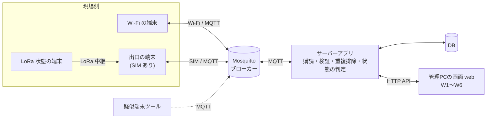
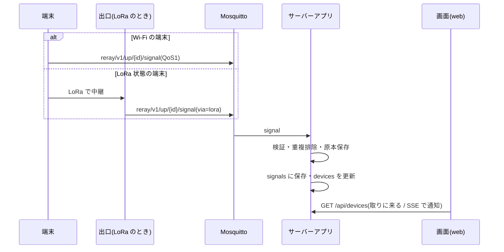
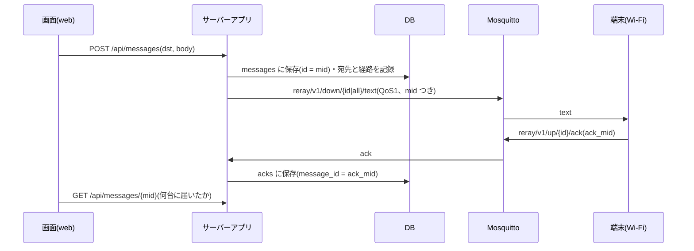

# ARCHITECTURE — サーバー側の設計書

> 更新: 2026-10-23 / 状態: **ドラフト**(言語・DB・MQTT クライアントは決定。フレームワークは M0 で決めて §10 を更新する)
> 範囲: 管理PC側(MQTT の購読 → 保存・判定 → API・文字の送信)
> 表記(【案】【修正案】【追加案】)は `../README.md` §3 を参照。

## この文書の要点

| 項目 | 決めたこと |
|---|---|
| 時刻 | サーバーの**受信時刻**を正とする。端末の `ts` は参考 |
| 「切れた」の判定 | **サーバーだけ**が決める(§5)【修正案】 |
| 重複 | 最終判定は**サーバー**。直近10分の `src` + `seq`(§6) |
| 文字の送信 | **DB に保存してから** MQTT に流す。DB の id が `mid`(§4.2)【修正案】 |
| 届いた | ack が戻ったときだけ。「流した」≠「届いた」 |
| LoRa 状態の端末 | 自由な文は届かない(Wi-Fi に戻れば届く)。**指示コード+ポジションは LoRa でも下ろす**(10/20 の決定) |
| 新しく持つもの | ポジション表・指示コード表・文字起こし(10/20 の決定。`INTERFACES_2026-10-23.md` §4.3) |
| 言語 | **TypeScript(Node.js 24)に決定**(§10) |
| DB | **MySQL に決定**(§10) |
| HTTP フレームワーク | **未決**(§10) |

---

## 1. 全体像



- Wi-Fi の端末は MQTT に直接つなぐ。LoRa 状態の端末は、出口が JSON にして代わりに流す(`via = lora`)。
- **保存・集計・「切れた」の判定・文字の送信の管理は、すべてこのサーバーが持つ。**
- 画面(web)は別パート。サーバーの API を使う前提で書く(web が MQTT に直接つなぐかは未決)。
- 出口がつながっていない間も、現場側(LoRa)は動き続ける。サーバーは「遅れて届く」「2回届く」を前提にする。

## 2. 設計方針

1. **受信時刻をサーバーが持つ。** `ts` は端末の時計で、Wi-Fi が無いと合わない。表示順と「何分前」は `received_at` を基準にする。
2. **「切れた」を決めるのはサーバーだけ。** 端末や出口の自己申告ではなく、受信の有無で判定する(§5)【修正案】。
3. **遅れて届く・2回届く、を前提にする。** 出口は回線断のあいだ溜めて、復旧後にまとめて流す。QoS1 は重複もありうる(§6)。
4. **文字は DB に保存してから流す。** DB の id が `mid` になり、ack との対応に使う(§4.2)【修正案】。
5. **「流した」は「届いた」ではない。** 届いたのは ack が戻ったときだけ。
6. **原本を残す。** 解釈できないものも、受信したそのままを `events` に残す【追加案】。
7. **検証用に割り切る範囲を明記する。** 認証なし・単一サーバー・ローカル LAN のみ(§9)。
8. **スコープを広げない。** 対象外:音声の処理(今期の文字起こしはアプリ側。サーバーは文を受けて配るだけ。サーバーで音声を受ける普段用の使い方は【将来】§12)、SIM 側の実装、管理サイトの作り込み、冗長化。地図(W7)はできれば。
9. **災害用を先に作る。** 文字起こしは、まず災害用(アプリで文字にして送る)から作る。普段用(音声をサーバーで文字にする)はあとから足す(§12)。

## 3. コンポーネント

### 3.1 ブローカー(Mosquitto)

- 端末・出口・サーバーアプリが、どれもクライアントとしてつなぐ。設定は `config/mosquitto.conf`。
- 置き場所(学校のPC / クラウド / ラズパイ)と製品は**未決**。検証版は **Docker の Mosquitto 2.0**(`compose.yaml`、10/23 に決定)。
- **永続化を有効**にする。理由は2つ:
  - サーバー再起動中の QoS1 を取りこぼさないため
  - 【修正案】Wi-Fi が切れた端末のあいだの text を溜め、戻ったときに渡すため(端末は `clean session = false`、クライアントID = 端末ID)

### 3.2 サーバーアプリ

| 部品 | 責務 |
|---|---|
| MQTT 受信 | `reray/v1/up/#` を購読し、受信時刻を付けて次へ渡す |
| 検証 | JSON か、`v`、`type`、`src` の形式、トピックとの整合(`INTERFACES_2026-10-23.md` §3) |
| 重複排除 | 直近10分に同じ `src` と `seq` の signal があれば捨てる(§6) |
| 保存 | signal・status・ack を保存(`DATA_MODEL_2026-10-23.md`)。原本を events に残す |
| 状態の判定 | `devices` の online・via・battery・glass を更新(§5) |
| 文字の送信 | 宛先を決め、DB に保存し、`mid` を付けて MQTT へ。ack との対応づけ(§4.2) |
| HTTP API | 画面へ、端末の状態・文字の送信・記録を渡す(`INTERFACES_2026-10-23.md` §4) |
| 本部に届いた【案】 | signal を保存したら、端末へ `down/{id}/ack` を返す(`INTERFACES_2026-10-23.md` §2.6) |
| ポジション・指示コード【案】 | 表を持ち、指示コードの形の下りで文を作る(`INTERFACES_2026-10-23.md` §4.3) |
| 文字起こし【案】 | アプリから文を受けて記録し、自由な文として配る |

### 3.3 DB

- チーム案の4表(devices / messages / signals / acks)+ 【案】positions / instruction_codes / transcripts + 追加案(message_targets、events)。
- **MySQL**(8.0 以上、InnoDB、`utf8mb4`)。サーバーアプリとは別のプロセスとして動かす。検証版は **Docker の MySQL 8.4**(`compose.yaml`。PC の MySQL とぶつからないよう 3307 番で出す)。
- 時刻は UTC の `DATETIME(3)` で持つ(`DATA_MODEL_2026-10-23.md` §1)。
- 接続情報(ホスト・ユーザー・パスワード)は `.env` に置き、git に入れない。

### 3.4 疑似端末ツール(`tools/`)【追加案】

実機がなくても M1〜M4 を進めるための検証用スクリプト。

- signal・status を、任意の端末ID・seq・コード・電池・グラスで publish(重複、seq の回り込み、`via = lora` を含む)
- text を受けて、遅延つきで ack を返す(返さない端末、Wi-Fi に戻ったあとで返す端末も)
- 回線断の模擬:publish を止めて溜め、あとでまとめて送る
- 遺言(Last Will)つきで接続し、突然切れる端末を作る

> [!NOTE]
> 目的は**サーバー側の入力の形を確かめること**。実機の挙動の再現ではない。実機の結果は M5 で別に記録する。

## 4. データの流れ

### 4.1 上り(端末 → サーバー)



- status は 30 秒ごと【案】。
- 【修正案】LoRa 状態の端末は、5分おきの「心拍」を出口が status の JSON に直して流す(`via = lora`)。
- 出口が複数だと、同じ signal が別々の出口から届くことがある。重複排除(§6)が受け止める。出口の識別は未決(§11)。

### 4.2 下り(サーバー → 端末)



**ポイント**

- **先に DB に保存し、id を得てから MQTT に流す**【修正案】。その id が `mid` で、ack の `ack_mid` と1対1に対応する。seq は 65535 で 0 に戻るため、seq だけでは特定できない。
- **自由な文**は Wi-Fi の端末にだけ届く。LoRa 状態の端末には、Wi-Fi に戻ればブローカーが溜めた text が届く。画面にもそう出す:
  `5台中4台に届いた(LoRa中: 1台 → つながり次第届きます)`
- **指示コード+ポジション**は、10/20 の決定で LoRa 状態の端末にも下ろす(出口が LoRa に直す)。出口へ渡す経路は未決(`INTERFACES_2026-10-23.md` §8)。
- ack の対応づけ:`ack_mid` があれば `messages.id` に直接。なければ(合意前の暫定)、同じ seq を持つ直近の messages に対応づけ、曖昧なら対応づけずに events に残す(`INTERFACES_2026-10-23.md` §2.4)。

## 5. 端末の状態(online)の判定

> **`devices.online` を書き換えるのはサーバーだけ。**【修正案】

| きっかけ | 結果 |
|---|---|
| 端末から何か届いた(status / signal / ack) | `online = true`、`last_seen_at` を更新 |
| 遺言(Last Will)が届いた(`online: false`) | `online = false` |
| Wi-Fi の端末から **90秒** 何も届かない(status の3回ぶん) | `online = false` |
| LoRa 状態の端末から **15分** 何も届かない(心拍の3回ぶん) | `online = false` |

**補足**

- `devices.via` は最後に届いたものの `via`。サーバーはこれで、90秒 / 15分のどちらを使うかを決める。**経路が分からない端末は 90秒。**
- 90秒・15分は【修正案】の値。実機の status の間隔が決まったら直す(定数は1か所に置く)。
- LoRa 状態の端末は status を Wi-Fi で送れない。心拍がないと、LoRa で生きていても「切れた」に見えてしまう。対策は心拍【修正案】。**ハード側の実装が決まるまで、サーバーは心拍を特別扱いせず status として受け取る。**
- **status が途絶えても SOS 扱いにはしない**【修正案】(v1)。W2 で「切れた」を目立たせるだけ。電池切れや圏外でも途絶えるため、誤って SOS を出すと本当の SOS が埋もれる。
- 判定は定期処理(数秒〜十数秒おき)。サーバー自身が止まっていたあとは、再起動直後に一斉に「切れた」にしない(受信を数十秒待ってから判定を始める)【追加案】。

## 6. 重複・遅延

**重複の最終判定はサーバー。** 出口・端末側の重複破棄は、LoRa 中継のループを止めるためのもの(役割が違う)。

| 状況 | 扱い |
|---|---|
| 同じ `src` と `seq` が直近10分にある(QoS1 の再配信、Wi-Fi と LoRa の両方) | 後から届いた方を捨てる(events に `duplicate`)。**先に届いた方を残す**(`via` も先の方) |
| DB の一意制約 | `(device_id, seq)` には**付けない**(seq が戻るため)。`(device_id, seq, received_at)` に索引【修正案】 |
| 端末の再起動で seq が 0 に戻る | 【修正案】端末は起動時に乱数(0〜65535)から始める。サーバーは10分の窓だけを見るので特別扱い不要 |
| 遅延到着(回線断のあと、まとめて届く) | 受信時刻順に保存。`ts` と受信時刻の差が大きければ、画面で参考として分かるようにする【追加案】 |
| 欠番(seq が飛ぶ) | エラーにしない(LoRa は取りこぼしがありうる) |
| ack の重複 | 同じ `message_id` と `device_id` は1行(最初の時刻を残す) |
| JSON が壊れている、`v` や `src` の形式が違う | 原本だけ保存して捨てる。サーバーは止まらない |
| 登録されていない端末からの signal / status | 保存し、`registered = 0` で表に作る。画面で分かる |

「直近10分」は【案】。再配信と二重経路を拾うには十分、という考えで、M4 の実測で見直す。

## 7. 回線断とサーバー再起動

| 状況 | 動き |
|---|---|
| 出口の回線が切れる | 出口が受信分をキューに溜める(ハード側)。サーバーには何も届かないが、**静かな期間を異常と見なさない**。ただし端末は §5 の時間を過ぎたら「切れた」になる |
| 出口の復旧 | キューが順に流れる。§6 の規則で扱う。心拍・status が届けば「つながった」に戻る |
| Wi-Fi が切れていた端末が戻る | ブローカーが溜めた text が届く。ack が返れば `GET /api/messages/{id}` の `acked_at` に入る(分母は変えない) |
| サーバーアプリが落ちる | ブローカーが QoS1 を溜める(永続セッション)。再起動後に受け取る。再起動直後の「切れた」判定は少し待つ(§5) |
| ブローカーが落ちる | 出口・端末は流せない。サーバーは再接続を繰り返す。`POST /api/messages` は 503 |
| ディスクが満杯 | 保存に失敗しても、プロセスは落とさず、エラーを画面とログに出す(原本の保存を最優先) |

## 8. 端末の登録

- 端末IDと持ち主の名前のひも付けは、サーバーの DB の `devices` が持つ(共通仕様 01 の案)。**W6 の「端末の登録」(`POST /api/devices`)で入れる。**
- 端末IDは `dev-` + 3桁(`dev-001`)。`0` と `65535` は端末に割り当てない。
- 端末IDをマイコンにどう書き込むか(直書き / 設定ファイル / サーバーが配る)は未決。サーバーは関与しない。
- 登録前の端末から先に届いた場合の扱いは §6。登録は後からでもできる。

## 9. セキュリティ

| 項目 | 検証版 | 製品で必要になること(対象外) |
|---|---|---|
| ブローカーの接続 | 匿名、ローカル LAN のみ | 認証、TLS、端末・出口ごとの ACL。**パスワードはこのリポジトリに書かない** |
| HTTP API | 認証なし、ローカル LAN のみ | ログイン(W1)、権限、操作の記録 |
| 文字の真正性 | サーバーは署名を検証しない(出口・端末側に任せる) | サーバー側の署名・鍵管理 |
| 入力の検証 | `INTERFACES_2026-10-23.md` §3。JSON 以外・大きすぎる本文は捨てる | レート制限、悪意のある出口への対処 |
| 個人情報 | 端末ID と持ち主の名前(W6)のみ | 保存期間、アクセス記録 |

ログインを作るか、API を守る方法、ブローカーの認証は、チームでも未決。ここでは検証版の割り切りだけ書く。

## 10. 技術選定(**言語・DB は決定。フレームワークは未決**)

### 10.0 決定事項

| 項目 | 決定 | 日付 |
|---|---|---|
| 言語 | **TypeScript**(Node.js 24 以上、ESM) | 2026-10-22 |
| 実行・ビルド | 開発は `tsx`、本番相当は `tsc` で `dist/` に出して `node` で実行 | 2026-10-22 |
| 疑似端末ツール(`tools/`) | サーバーと同じ TypeScript で書く(基準 4) | 2026-10-22 |
| MQTT クライアント | **MQTT.js**(`mqtt` 5.16 系。MQTT 3.1.1 でつなぐ) | 2026-10-23 |
| HTTP フレームワーク | 未決(M2 までに決める) | 未決 |
| DB | **MySQL**(8.0 以上) | 2026-10-22 |
| DB の接続ライブラリ | `mysql2`(第一候補。M1 で入れる) | 未決 |
| 検証の動かし方 | **Docker**(Mosquitto 2.0・MySQL 8.4。サーバーアプリは手元、本番に近い形で試すときだけ Docker) | 2026-10-23 |
| DB・ブローカーの本番の置き場所 | 未決(本番はネット上) | 未決 |

- 言語を決めた理由:画面(web)と言語をそろえ、JSON の型や API の定義を共有しやすくするため(基準 5)。
- 懸念だった「設定が増えやすい」は、`tsx` と最小の `tsconfig.json` で抑える。
- MySQL を使うと、SQLite(1ファイル)と違って DB のサーバーを別に動かす必要がある。メンバー全員が手元で同じ DB を動かせるよう、起動手順を README の「使い方」に書く(M1)。
- 以下の 10.1〜10.3 は、決めたときの比較の記録として残す。

### 10.1 決めるときの基準

1. 開発メンバーが、短い期間で書ける・読める
2. MQTT の常駐購読と HTTP API(必要なら SSE)を、少ない部品で組める
3. Windows / PowerShell で動かしやすい
4. 疑似端末ツール(`tools/`)も同じ言語で書ける
5. 画面(web)担当の言語と、型や API の定義を共有できる

### 10.2 候補

| 候補 | 利点 | 懸念 |
|---|---|---|
| **Python**(FastAPI + paho-mqtt + SQLite) | 疑似端末・ログ解析も同じ言語。部品が少ない。ハード試作の検証ツールも Python | 画面が TypeScript や PHP なら言語がそろわない |
| **TypeScript**(Node.js + MQTT.js + SQLite) | 画面と同じ言語にできる。型を共有しやすい | 設定が増えやすい |
| **PHP**(Laravel + MQTT クライアント) | API・DB・認証を一式で作れる | MQTT の常駐購読を別のワーカーで動かす構成になる |

### 10.3 推奨案(決定前の記録)

- 基準 5(画面担当と言語がそろうか)と基準 1(習熟度)を**最優先**にする。画面の技術が先に決まっていれば、それに合わせるのが現実的。
- 画面の技術が未定、または分かれてよいなら、**Python + SQLite** を第一案とする(基準 2・4 を満たしやすい)。
- 決めたら、この節を「決定」に書き換え、`../README.md` の「使い方」を具体化する。設計は言語を変えても使える。

## 11. 設計上の前提と未確認

| # | 内容 | 状態 |
|---|---|---|
| 1 | 仕様修正案の扱い(10/22 のまとめ §6) | #3(seq の乱数・重複の役割分担)と #4(online はサーバーだけ・90秒/15分・自動 SOS にしない)は**採用**。#2(`mid` / `ack_mid`)は共通仕様への反映待ち。#1 は「指示コードは LoRa でも下ろす」に一部置きかえ |
| 1b | 10/20 の決定で増えた項目(ポジション・指示コード・本部に届いた・文字起こし)の形 | 共通仕様に入るまで【案】で作る(`INTERFACES_2026-10-23.md` §8) |
| 2 | LoRa 状態の端末(心拍)の status の項目名 | 未確認。`via`、`battery` で書いたが、共通仕様の更新を待つ |
| 3 | 出口が複数のときの識別(トピックに出口IDがない) | 未決。検証は出口1台の想定 |
| 4 | 「SOS が届いた」状態の解除のしかた(W2 の並び順) | 未決。暫定は、最新の signal が SOS でなくなるまで |
| 5 | 90秒 / 15分 / 10分の値 | 仮置き。M4・M5 で調整 |
| 6 | web が MQTT に直接つなぐか、API を通すか | チーム未決。API 経由で書いた |
| 7 | 新着の知らせ方(取りに来る / 押し出す) | チーム未決。API だけで成り立つ形にし、SSE を追加案とした |
| 8 | text の ack の範囲 | 【修正案】v1 は「端末に届いた」まで |
| 9 | ブローカーとサーバーの置き場所(本番はネット上) | 検証は Docker(10/23)。本番は未決 |

## 12. 文字起こしの2つの使い方と、作る順番

2026-10-22 に決めた順番:**災害用(A)を先に作り、普段用(B)はあとから足す。**

| | A. 災害用(今期に作る) | B. 普段用(【将来】あとから足す) |
|---|---|---|
| 声を文字にする場所 | 文字起こしアプリ(ブラウザの音声認識かスマホの機能) | サーバー |
| サーバーに届くもの | 文字だけ | 音声(1文で数十 KB〜数百 KB) |
| 入口 | 【案】`POST /api/transcripts`(`INTERFACES_2026-10-23.md` §4.3) | 【将来】MQTT(下の表) |
| 回線 | 細い回線でも届く | Wi-Fi のときだけ。LoRa には載らない |
| サーバーに要るもの | 今の設計のまま | 文字起こしの仕組み(Whisper など)と、それを動かす性能 |

どちらも、文字にしたあとは同じ流れ(`transcripts` に記録 → `messages` を作る → `reray/v1/down/{id|all}/text` に流す)にする。**B を足すときに変わるのは入口だけ**になるよう、A を作る段階で「文を受け取ったあと」の処理を1か所にまとめておく。

### 12.1 B(普段用)の構成の案【将来】

```
[文字起こしアプリ(ブラウザ/スマホ)]
   │ MQTT v5 over WebSocket(wss)… 音声をそのままバイナリで送る
[Mosquitto 2.x]
   │ MQTT v5(TCP)
[サーバー]
   ├─ 受けた音声を順番待ちの列に入れる → 文字起こし
   ├─ MySQL:transcripts / messages に保存
   ├─ reray/v1/down/{id|all}/text に流す(A と同じ)
   └─ 結果をアプリに返す(送る前に確かめて直す FT-03 用)
```

| 項目 | 案 | 理由 |
|---|---|---|
| ブローカー | Mosquitto 2.x(今のまま) | v5 と WebSocket に対応している。1文ずつなら性能は足りる |
| プロトコル | MQTT v5 | 宛先・形式・発話 ID をプロパティに載せ、本体は音声のバイナリだけにできる(Base64 だと約 33% 大きくなる)。返事の宛先(Response Topic)も使える |
| アプリからの接続 | wss(WebSocket + TLS) | ブラウザは普通の MQTT(TCP)で接続できない。マイクを使うページは https が必要で、https のページからは wss にしかつなげない |
| 音声の送り方 | 1文 = 1メッセージ。Opus(WebM)で圧縮し、長さは約15秒まで | 細かく分けて流す方式は、組み立て直しと抜けへの対策が増える |
| QoS / retain | QoS 1、retain なし | 古い音声が後から接続した人に流れないように |
| 大きさの上限 | Mosquitto の `max_packet_size` を約 1 MB に | 大きすぎるデータでブローカーが重くならないように |
| 認証 | ユーザー名とパスワード + TLS | 音声は漏れると困る。暗号化のない Wi-Fi(00000JAPAN)も通る前提 |
| サーバー側の処理 | 受信と文字起こしを分ける(順番待ちの列) | 文字起こしに数秒かかっても、SOS の受信を止めない |

| トピックの案 | 向き | 中身 |
|---|---|---|
| `reray/v1/up/app/{appId}/audio` | アプリ → サーバー | 音声のバイナリ。プロパティに `dst`・`format`・`utterance_id` |
| `reray/v1/down/app/{appId}/transcript` | サーバー → アプリ | 文字にした結果 |

**B を作るときに決めること**:文字起こしの仕組み(手元の PC で Whisper を動かすか、クラウドのサービスを使うか。クラウドは回線が切れると使えない)、サーバーの性能(GPU の有無)、共通仕様 03 へのトピックの追加。
