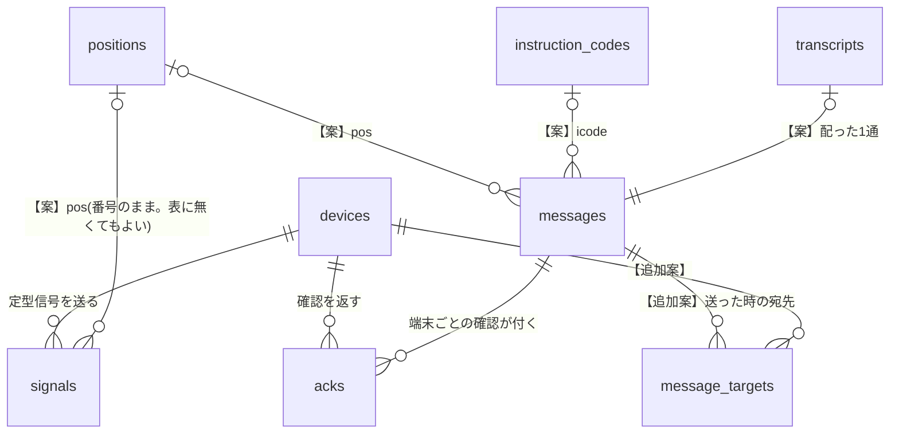

# DATA_MODEL — データモデルと集計規則

> 更新: 2026-10-23 / 状態: **ドラフト**(10/20 の決定で positions / instruction_codes / transcripts を【案】で追加)
> チームのテーブル案(`サーバーサイド/02_テーブル定義`:devices / messages / signals / acks の4表)を**正**とし、仕様修正案(10/16)の変更と、サーバー側だけの追加を重ねる。表記は `../README.md` §3。
> DB は **MySQL に決定**(2026-10-22)。型は MySQL の書き方(MySQL 8.0 以上、InnoDB、文字コード `utf8mb4`)。

## 早見表

| 表 | 出どころ | 役割 |
|---|---|---|
| `devices` | チーム案 | 端末と、その今の状態 |
| `messages` | チーム案 | 管理PCが送った文字 |
| `signals` | チーム案 | 端末から届いた定型信号 |
| `acks` | チーム案 | 届いた確認 |
| `positions` | 【案】10/20 の決定 | ポジション番号と名前・場所(W8) |
| `instruction_codes` | 【案】10/20 の決定 | 指示コードと文 |
| `transcripts` | 【案】10/20 の決定 | 文字起こしアプリから届いた文 |
| `message_targets` | 【追加案】 | 送った時の宛先と経路(「N台中M台」の分母) |
| `events` | 【追加案】 | 受信・送信の原本 |

## 1. 方針

- **時刻はサーバーが受け取った時刻(`received_at`)を正とする。** 端末の `ts` は参考(`device_ts`)。マイコンは Wi-Fi が無いと時刻を合わせられないため。
- 時刻は `DATETIME(3)`(ミリ秒まで)に **UTC** で保存し、API で日本時間(+09:00)の ISO 8601 にして返す。DB への接続で時間帯を `+00:00` に固定する(PC の時間帯に左右されないように)。
- 真偽は `TINYINT(1)`(0 / 1)。`via`・`kind` などの決まった値は `VARCHAR` で持ち、値の確かめはサーバーのコードで行う(`ENUM` は値を足すたびに表を変える必要があるため使わない)。
- 文字コードは `utf8mb4`(日本語と絵文字を入れても壊れないように)。
- 端末ID は JSON と同じ `dev-NNN` の文字列。LoRa の u16 との変換は端末側の話で、サーバーは文字列だけを扱う。
- 検証用なので、索引は最小限。端末数十台 × 数時間の規模を想定する。

## 2. 表どうしの関係

- `signals.pos`・`messages.pos` は外部キーにしない(ポジションを消しても、過去の記録の番号は残すため)。

## 3. 本体の表(チーム案の4表 + 10/20 の決定で増えた3表)

### 3.1 devices(端末)

| 列 | 型 | 中身 |
|---|---|---|
| `id` | VARCHAR(16) PK | 端末ID。`dev-001` |
| `owner` | VARCHAR(64) | 持ち主の名前 |
| `online` | TINYINT(1) | つながっているか。**更新するのはサーバーだけ**(`ARCHITECTURE_2026-10-23.md` §5)【修正案】 |
| `via` | VARCHAR(8) | 最後に届いた経路。`wifi` / `lora` |
| `battery` | TINYINT UNSIGNED(空可) | 電池の残り(%) |
| `glass` | TINYINT(1) | グラスとつながっているか |
| `last_seen_at` | DATETIME(3) | 最後に何か届いた時刻 |
| `pos` | TINYINT UNSIGNED(空可) | 【案】最後に届いた signal のポジション番号(W2 のポジション列) |
| `lat`・`lon` | DOUBLE(空可) | 【案】最後に届いた status の GPS(できれば。W7) |
| `created_at` | DATETIME(3) | 登録した時刻 |
| `registered` | TINYINT(1) | 【追加案】1=W6 で登録した端末、0=受信して初めて見つけた端末(`owner` は空) |

### 3.2 messages(管理PCが送った文字)

| 列 | 型 | 中身 |
|---|---|---|
| `id` | INT UNSIGNED PK AUTO_INCREMENT | 【修正案】text の `mid`、ack の `ack_mid` になる |
| `seq` | SMALLINT UNSIGNED | 送信の連番(`pc` の u16) |
| `dst` | VARCHAR(16) | 宛先。端末ID か `all` |
| `body` | VARCHAR(255) | 本文。指示コードの形なら、サーバーが作った文 |
| `kind` | VARCHAR(8) | 【案】`free`(自由な文)/ `order`(指示コード+ポジション) |
| `icode` | TINYINT UNSIGNED(空可) | 【案】指示コード。`kind = order` のときだけ |
| `pos` | TINYINT UNSIGNED(空可) | 【案】ポジション番号。`kind = order` のときだけ |
| `source` | VARCHAR(16) | 【案】`web`(管理画面)/ `transcript`(文字起こし) |
| `sent_at` | DATETIME(3) | 送った時刻 |
| `publish_state` | VARCHAR(16) | 【追加案】`sent`(PUBACK を受けた)/ `failed`(流せなかった) |

### 3.3 signals(端末から届いた定型信号)

| 列 | 型 | 中身 |
|---|---|---|
| `id` | INT UNSIGNED PK AUTO_INCREMENT | |
| `device_id` | VARCHAR(16)(devices.id) | 送った端末 |
| `seq` | SMALLINT UNSIGNED | 端末の連番 |
| `code` | TINYINT UNSIGNED | 定型信号のコード(1〜31。1=SOS。一覧は共通仕様 01) |
| `pos` | TINYINT UNSIGNED | 【案】ポジション番号。無ければ 0(場所なし) |
| `n` | TINYINT UNSIGNED(空可) | 【案】数量。5 人きざみの区分の上限(5〜100)。数を使わない信号では空(`SIGNAL_FORMAT_2026-10-23.md`) |
| `via` | VARCHAR(8) | 届いた経路。`wifi` / `lora` |
| `device_ts` | DATETIME(3)(空可) | 端末が付けた時刻。参考 |
| `received_at` | DATETIME(3) | サーバーが受け取った時刻。**こちらを正にする** |

- 【修正案】`(device_id, seq)` に**一意制約は付けない**(seq は 65535 の次に 0 に戻り、同じ組が正当に再び出るため)。代わりに `(device_id, seq, received_at)` に索引を付ける。
- 重複の判定は DB の制約ではなく**サーバーのコード**で行う:直近10分に同じ `device_id` と `seq` があれば捨てる【案】(`ARCHITECTURE_2026-10-23.md` §6)。

### 3.4 acks(届いた確認)

| 列 | 型 | 中身 |
|---|---|---|
| `id` | INT UNSIGNED PK AUTO_INCREMENT | |
| `message_id` | INT UNSIGNED(messages.id) | どの1通への確認か。【修正案】`ack_mid` から直接入れる |
| `device_id` | VARCHAR(16)(devices.id) | 確認を返した端末 |
| `acked_at` | DATETIME(3) | サーバーが受け取った時刻 |

- **同じ `message_id` と `device_id` の組は1行だけ**(一意制約)。同じ端末から2回届いても、最初の時刻を残す。
- 対応づけられない ack(該当する text が無い、`ack_mid` が無く曖昧)は、この表に入れず、`events`(§4.2)に残す。

### 3.5 positions(ポジション表)【案】

10/20 の決定:番号は端末に、名前と場所は本部の画面(W8)で付ける・変える。

| 列 | 型 | 中身 |
|---|---|---|
| `no` | TINYINT UNSIGNED PK | ポジション番号(1〜255【案】。0 は「場所なし」で表に入れない) |
| `name` | VARCHAR(64) | 名前。「北口」「体育館前」 |
| `place` | VARCHAR(255)(空可) | 場所の説明 |
| `updated_at` | DATETIME(3) | 最後に変えた時刻 |

- 名前を変えても、過去の signals・messages の `pos` は番号のまま。画面は**今の名前**で出す(当時の名前は残さない)。当時の名前が要るかは要相談。

### 3.6 instruction_codes(指示コード表)【案】

| 列 | 型 | 中身 |
|---|---|---|
| `code` | TINYINT UNSIGNED PK | 指示コード(1〜255【案】) |
| `text` | VARCHAR(64) | 文。「へ移動」「に集合」「から退避」 |
| `updated_at` | DATETIME(3) | 最後に変えた時刻 |

- 端末も同じ番号を使うので、一覧は共通仕様 01 と同じにする。行は消さない。

### 3.7 transcripts(文字起こし)【案】

| 列 | 型 | 中身 |
|---|---|---|
| `id` | INT UNSIGNED PK AUTO_INCREMENT | |
| `body` | VARCHAR(255) | 文字にした文 |
| `dst` | VARCHAR(16) | 宛先。端末ID か `all` |
| `speaker` | VARCHAR(64)(空可) | 話した人 |
| `received_at` | DATETIME(3) | サーバーが受け取った時刻 |
| `message_id` | INT UNSIGNED(空可) | 配った messages.id。配れなかったら空 |

- 文字起こしの文は、`messages`(`source = transcript`)として配る。この表は「アプリから何が届いたか」の記録。`messages` だけで足りるなら作らなくてもよい。

## 4. 追加案の表

### 4.1 message_targets(送った時の宛先)【追加案】

「6台中4台に届いた」の分母を、**送った時点の状態で残す**ための表(`INTERFACES_2026-10-23.md` §4.1)。

| 列 | 型 | 中身 |
|---|---|---|
| `message_id` | INT UNSIGNED | messages.id |
| `device_id` | VARCHAR(16) | 宛先として数えた端末(`dst` が `all` なら登録済みの全端末) |
| `via_at_send` | VARCHAR(8) | 送った時の経路。`wifi` / `lora`(`devices.via` と `online` から決める。`online` でない端末は最後の経路のまま) |

- 主キー:`(message_id, device_id)`
- 【修正案】分母は `via_at_send = 'wifi'` の端末。`lora` の端末は別に数える。
- 【案】`messages.kind = order`(指示コード)なら LoRa でも下ろすので、`lora` の端末も分母に入れる。

### 4.2 events(受信・送信の原本)【追加案】

受信・送信した MQTT メッセージを、解釈の前に残す。他の表が壊れても作り直せるようにする(企画書の「言った言わない」を減らす狙い)。

| 列 | 型 | 中身 |
|---|---|---|
| `id` | INT UNSIGNED PK AUTO_INCREMENT | |
| `received_at` | DATETIME(3) | 受信・送信した時刻 |
| `direction` | VARCHAR(8) | `up`(受信)/ `down`(送信) |
| `topic` | VARCHAR(255) | MQTT トピック |
| `payload` | TEXT | 本文(そのまま。大きすぎれば切り詰め) |
| `result` | VARCHAR(16) | `accepted` / `duplicate`(重複で捨てた)/ `invalid`(不正)/ `unmatched`(対応づけられない ack)/ `sent` / `failed` |
| `note` | VARCHAR(255) | 理由(例 `v!=1`、`src mismatch`) |

チームの4表だけで足りるなら、この表を作らなくてもよい。作らない場合も、`/api/logs` の元は signals・acks・messages になる。

## 5. 将来の拡張(今は作らない)

| 項目 | 内容 |
|---|---|
| 区域 | 10/20 の決定で「ポジション」(§3.5)に置きかわった |
| users | ログインを作るなら必要(未決。W1 はできれば) |
| signal_codes | 定型信号の名前を表で持つか、プログラム・画面に書くか(未決)。最大31種類になったので、表で持つ方がよいかもしれない。今は数値のまま保存し、名前は画面側 |
| 状態の履歴 | 電池や接続の移り変わりを残すか(未決)。今は最新の値だけ `devices` に持つ |

## 6. 集計規則(派生。保存せず、問い合わせで出してよい)

### 6.1 端末の最新の定型信号(`last_signal`)

- その端末の signals のうち、`received_at` が最も新しい 1 件。
- 回線断のあとに古い signal が遅れて届くと、**受信時刻が新しいので一時的に「最新」になる**。`device_ts` との差が大きければ、画面で参考として分かるようにする【追加案】。

### 6.2 W2 の並び順【案】

1. SOS が届いた端末(最新の signal のコードが 1。解除のしかたは未決で、今は最新の signal が SOS でなくなるまで)
2. 切れた端末(`online = 0`)
3. それ以外

### 6.3 1通の届き具合

- `message_targets` と `acks` を突き合わせて、`wifi` の宛先の総数と ack の数、`lora` の宛先の総数と ack の数を出す。
- 宛先外の端末の ack は数えない。

## 7. 保持と容量

- ログをいつまで残すかは未決(チーム)。検証の期間中は削除しない。
- DB は MySQL。検証版は Docker の MySQL 8.4(`compose.yaml`)、本番の置き場所は未決。データは Docker のボリューム `mysql-data` に残る。接続情報は `.env` に書き、git に入れない。実測のデータは CSV に出して `logs/` に、日付と条件が分かるファイル名で保存する(例 `logs/2026-10-20_m5_text-10x.csv`)。
