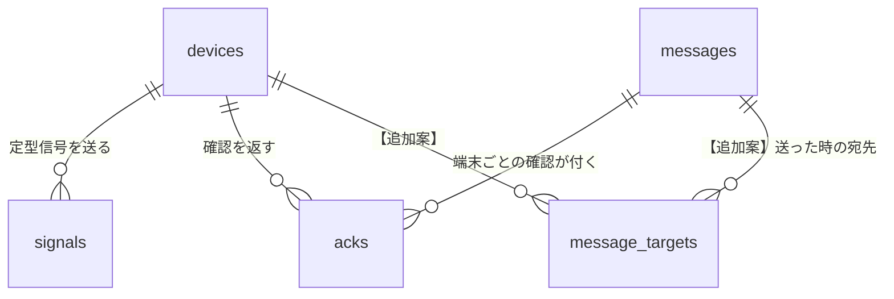

# DATA_MODEL — データモデルと集計規則

> 更新: 2026-10-16 / 状態: **ドラフト**
> チームのテーブル案(`サーバーサイド/02_テーブル定義`:devices / messages / signals / acks の4表)を**正**とし、仕様修正案(10/16)の変更と、サーバー側だけの追加を重ねる。表記は `../README.md` §3。
> DB の種類は未決(第一候補は SQLite)。型は SQLite の書き方だが、MySQL / PostgreSQL にも読み替えられる。

## 早見表

| 表 | 出どころ | 役割 |
|---|---|---|
| `devices` | チーム案 | 端末と、その今の状態 |
| `messages` | チーム案 | 管理PCが送った文字 |
| `signals` | チーム案 | 端末から届いた定型信号 |
| `acks` | チーム案 | 届いた確認 |
| `message_targets` | 【追加案】 | 送った時の宛先と経路(「N台中M台」の分母) |
| `events` | 【追加案】 | 受信・送信の原本 |

## 1. 方針

- **時刻はサーバーが受け取った時刻(`received_at`)を正とする。** 端末の `ts` は参考(`device_ts`)。マイコンは Wi-Fi が無いと時刻を合わせられないため。
- 時刻は UTC の ISO 8601 文字列で保存し、API で日本時間(+09:00)にして返す。
- 端末ID は JSON と同じ `dev-NNN` の文字列。LoRa の u16 との変換は端末側の話で、サーバーは文字列だけを扱う。
- 検証用なので、索引は最小限。端末数十台 × 数時間の規模を想定する。

## 2. 表どうしの関係

## 3. チーム案の4表

### 3.1 devices(端末)

| 列 | 型 | 中身 |
|---|---|---|
| `id` | TEXT PK | 端末ID。`dev-001` |
| `owner` | TEXT | 持ち主の名前 |
| `online` | INTEGER(真偽) | つながっているか。**更新するのはサーバーだけ**(`ARCHITECTURE.md` §5)【修正案】 |
| `via` | TEXT | 最後に届いた経路。`wifi` / `lora` |
| `battery` | INTEGER(空可) | 電池の残り(%) |
| `glass` | INTEGER(真偽) | グラスとつながっているか |
| `last_seen_at` | TEXT | 最後に何か届いた時刻 |
| `created_at` | TEXT | 登録した時刻 |
| `registered` | INTEGER | 【追加案】1=W6 で登録した端末、0=受信して初めて見つけた端末(`owner` は空) |

### 3.2 messages(管理PCが送った文字)

| 列 | 型 | 中身 |
|---|---|---|
| `id` | INTEGER PK(自動) | 【修正案】text の `mid`、ack の `ack_mid` になる |
| `seq` | INTEGER | 送信の連番(`pc` の u16) |
| `dst` | TEXT | 宛先。端末ID か `all` |
| `body` | TEXT | 本文 |
| `sent_at` | TEXT | 送った時刻 |
| `publish_state` | TEXT | 【追加案】`sent`(PUBACK を受けた)/ `failed`(流せなかった) |

### 3.3 signals(端末から届いた定型信号)

| 列 | 型 | 中身 |
|---|---|---|
| `id` | INTEGER PK(自動) | |
| `device_id` | TEXT(devices.id) | 送った端末 |
| `seq` | INTEGER | 端末の連番 |
| `code` | INTEGER | 定型信号のコード(1=SOS、2=無事、3=助けて、4=食料) |
| `via` | TEXT | 届いた経路。`wifi` / `lora` |
| `device_ts` | TEXT(空可) | 端末が付けた時刻。参考 |
| `received_at` | TEXT | サーバーが受け取った時刻。**こちらを正にする** |

- 【修正案】`(device_id, seq)` に**一意制約は付けない**(seq は 65535 の次に 0 に戻り、同じ組が正当に再び出るため)。代わりに `(device_id, seq, received_at)` に索引を付ける。
- 重複の判定は DB の制約ではなく**サーバーのコード**で行う:直近10分に同じ `device_id` と `seq` があれば捨てる【案】(`ARCHITECTURE.md` §6)。

### 3.4 acks(届いた確認)

| 列 | 型 | 中身 |
|---|---|---|
| `id` | INTEGER PK(自動) | |
| `message_id` | INTEGER(messages.id) | どの1通への確認か。【修正案】`ack_mid` から直接入れる |
| `device_id` | TEXT(devices.id) | 確認を返した端末 |
| `acked_at` | TEXT | サーバーが受け取った時刻 |

- **同じ `message_id` と `device_id` の組は1行だけ**(一意制約)。同じ端末から2回届いても、最初の時刻を残す。
- 対応づけられない ack(該当する text が無い、`ack_mid` が無く曖昧)は、この表に入れず、`events`(§4.2)に残す。

## 4. 追加案の表

### 4.1 message_targets(送った時の宛先)【追加案】

「6台中4台に届いた」の分母を、**送った時点の状態で残す**ための表(`INTERFACES.md` §4.1)。

| 列 | 型 | 中身 |
|---|---|---|
| `message_id` | INTEGER | messages.id |
| `device_id` | TEXT | 宛先として数えた端末(`dst` が `all` なら登録済みの全端末) |
| `via_at_send` | TEXT | 送った時の経路。`wifi` / `lora`(`devices.via` と `online` から決める。`online` でない端末は最後の経路のまま) |

- 主キー:`(message_id, device_id)`
- 【修正案】分母は `via_at_send = 'wifi'` の端末。`lora` の端末は別に数える。

### 4.2 events(受信・送信の原本)【追加案】

受信・送信した MQTT メッセージを、解釈の前に残す。他の表が壊れても作り直せるようにする(企画書の「言った言わない」を減らす狙い)。

| 列 | 型 | 中身 |
|---|---|---|
| `id` | INTEGER PK | |
| `received_at` | TEXT | 受信・送信した時刻 |
| `direction` | TEXT | `up`(受信)/ `down`(送信) |
| `topic` | TEXT | MQTT トピック |
| `payload` | TEXT | 本文(そのまま。大きすぎれば切り詰め) |
| `result` | TEXT | `accepted` / `duplicate`(重複で捨てた)/ `invalid`(不正)/ `unmatched`(対応づけられない ack)/ `sent` / `failed` |
| `note` | TEXT | 理由(例 `v!=1`、`src mismatch`) |

チームの4表だけで足りるなら、この表を作らなくてもよい。作らない場合も、`/api/logs` の元は signals・acks・messages になる。

## 5. 将来の拡張(今は作らない)

| 項目 | 内容 |
|---|---|
| 区域 | 企画書やハード試作には端末番号と区域の対応表があるが、チーム仕様にはない(地図も出さない)。必要になったら `devices` に `zone` 列(空可)を足す |
| users | ログインを作るなら必要(未決) |
| signal_codes | 定型信号の名前を表で持つか、プログラム・画面に書くか(未決)。今は数値のまま保存し、名前は画面側 |
| 状態の履歴 | 電池や接続の移り変わりを残すか(未決)。今は最新の値だけ `devices` に持つ |

## 6. 集計規則(派生。保存せず、問い合わせで出してよい)

### 6.1 端末の最新の定型信号(`last_signal`)

- その端末の signals のうち、`received_at` が最も新しい 1 件。
- 回線断のあとに古い signal が遅れて届くと、**受信時刻が新しいので一時的に「最新」になる**。`device_ts` との差が大きければ、画面で参考として分かるようにする【追加案】。

### 6.2 W2 の並び順【案】

1. SOS が届いた端末(最新の signal のコードが 1。解除のしかたは未決で、今は最新の signal が SOS でなくなるまで)
2. 切れた端末(`online = 0`)
3. それ以外

### 6.3 1通の届き具合

- `message_targets` と `acks` を突き合わせて、`wifi` の宛先の総数と ack の数、`lora` の宛先の総数と ack の数を出す。
- 宛先外の端末の ack は数えない。

## 7. 保持と容量

- ログをいつまで残すかは未決(チーム)。検証の期間中は削除しない。
- DB のファイルは `data/` に置き、git に入れない。実測のデータは CSV に出して `logs/` に、日付と条件が分かるファイル名で保存する(例 `logs/2026-10-20_m5_text-10x.csv`)。
